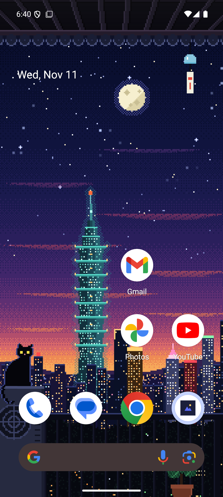

# Planetarium

Android 動態桌布 App。把照片、影片、分層圖片或 GLSL shader 做成桌布,傾斜手機時各層依遠近滑動,看起來有空間感。
主畫面和鎖定畫面可以各用一張。



## 能做什麼

| 來源 | 說明 |
|------|------|
| 圖片 | 把一張照片設成桌布。 |
| 影片 | 循環播放的動態桌布。 |
| 照片轉空間桌布 | 在手機上分析照片的景深,傾斜時有立體感。全程離線。 |
| 分層空間桌布 | 多張圖片依遠近疊放。 |
| Shader / 桌布包 | 匯入 `.frag`、桌布包 `.zip`,或使用內建範例;也可以用內建編輯器從範本寫 shader。 |
| AI 生成桌布 | 在 App 裡開啟[空間桌布編輯器](https://github.com/EntropicRegression/planetarium-editor),用文字和參考圖讓 AI 排出分層桌布。需要網路和你自己的 API 金鑰。 |

另外:

- **幀率上限與解析度**:在設定裡調整動態桌布每秒最多畫幾格(10–60)和繪製解析度(50–100%),手機太燙時用。
- **測量效能負擔**:在桌布的選單裡,量這張桌布在這支手機上畫一格要多久、每一層各佔多少。
- 桌布看不見時不繪製;省電模式下會降低幀率。

## 桌布包

一個桌布包是一個資料夾或 `.zip`,裡面有 `manifest.json` 和它用到的圖片、影片、shader。
桌布包只有資料,除了在 GPU 上跑的片段著色器以外不會執行任何程式碼。格式見 [docs/PACK_FORMAT.md](docs/PACK_FORMAT.md)。

在電腦上製作桌布包可以用[空間桌布編輯器](https://github.com/EntropicRegression/planetarium-editor),匯出的 `.zip` 直接在 App 裡匯入。

## 建置

需要 Android Studio 或 Android SDK(compileSdk 35)。App 支援 Android 9(API 28)以上。

1. 取得原始碼,並把編輯器放進 `spatial-editor/`(它是另一個 repo,建置時會把它的網頁檔案包進 App):

   ```bash
   git clone https://github.com/EntropicRegression/planetarium.git
   ```

   ```bash
   git clone https://github.com/EntropicRegression/planetarium-editor.git planetarium/spatial-editor
   ```

2. 下載景深模型(99 MB,不放在 git 裡;「照片轉空間桌布」需要它):

   ```powershell
   powershell -ExecutionPolicy Bypass -File scripts\fetch-depth-model.ps1
   ```

3. 建置並安裝到接上的手機:

   ```bash
   ./gradlew installDebug
   ```

   `./gradlew assembleRelease` 產出的 APK 在 `app/build/outputs/apk/release/`。
   release 版目前用 debug 金鑰簽署,只適合自己安裝。

## 程式結構

```
app/src/main/java/app/planetarium/
  engine/   桌布服務與繪製:Renderer(繪製執行緒)、Scene、ImageLayer / VideoLayer / ShaderLayer、Benchmark
  pack/     桌布包的讀取與儲存(WallpaperPack、PackStore)
  ui/       桌布庫、各種匯入流程、設定
  depth/    照片的景深估計
  studio/   App 內的 AI 編輯器(本機伺服器 + WebView)
app/src/main/assets/
  samples/  內建範例桌布
  effects/  內建的雨、雪、塵埃效果
docs/       桌布包格式、測試清單
tools/      產生圖示與範例素材的腳本
```

桌布服務跑在獨立的行程(`:wallpaper`),和 App 的畫面分開。

## 權限與隱私

- App 只要求網路權限,而且只有「AI 生成桌布」這個畫面會用到。
- API 金鑰只存在手機上,只會送到你選的那家 AI 服務。
- 其他功能(包含照片轉空間桌布的景深分析)都在手機上完成。

## 第三方

- 景深模型:[Depth Anything V2 Small](https://huggingface.co/onnx-community/depth-anything-v2-small)(Apache-2.0),以 ONNX Runtime 執行。

## 授權

[GPL-3.0](LICENSE)。你可以使用、修改和散布這份程式;散布修改後的版本時,必須以同樣的授權公開原始碼。
